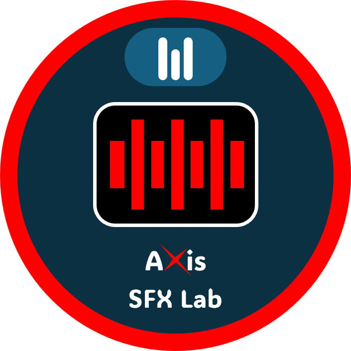

<div align="center">

<picture>
  <source media="(prefers-color-scheme: dark)" srcset="docs/assets/Axis%20Tools%20Dark.png">
  <source media="(prefers-color-scheme: light)" srcset="docs/assets/Axis%20Tools%202.png">
  
</picture>

# Axis SFX Lab

**Next-Gen Native Procedural Synthesizer, Real SFX & Foley Audio Suite**

[](https://github.com/MooPuu/axis-sfx-lab/releases/tag/v1.0.0)
[](https://moopuu.github.io/axis-sfx-lab/)
[](https://www.rust-lang.org)
[](https://tauri.app)
[](https://moopuu.github.io/axis-sfx-lab/)
[](LICENSE)
[](https://github.com/MooPuu/axis-sfx-lab/releases/tag/v1.0.0)

<p align="center">
  <a href="https://moopuu.github.io/axis-sfx-lab/" target="_blank"><strong>🌐 Visit Official Website & Interactive Audio Showcase</strong></a>
</p>

<p align="center">
  
</p>

*A blazingly fast, lightweight, and modern desktop audio application designed for game developers, sound designers, and interactive media creators. Generate high-quality procedural sound effects, realistic foley acoustics, and seamless loops with instant real-time waveform feedback.*

</div>

---

## 🌟 Overview

**Axis SFX Lab** is part of the **Axis Tools** open-source game development ecosystem. Engineered with a native **Rust + Tauri v2** architecture, it replaces heavy, bloated multi-gigabyte digital audio workstations with a standalone binary under **20 MB** that launches in **100 milliseconds** while retaining a sleek, modern visual interface.

Generate complete, production-ready audio assets (Impacts, Foley Footsteps, Sci-Fi Energy, UI Clicks, Whooshes, Explosions, Weapons, Weather, Ambient Drones, Retro 8-bit, Magic, and Creatures) with real-time waveform visualization, mathematical zero-crossing loop markers, and organic micro-variation randomizers.

---

## ✨ Features

### 🎛️ 13 Procedural Synthesis Engines & 838 Presets
- **Impacts & Hits**: Physical modal resonators for metal, wood, glass, stone, and flesh impacts, body falls, and sub-bass cinematic booms.
- **Motors & Servos**: Electric motors, hydraulic pistons, mechanical ratchets, and continuous robot joint movement loops.
- **UI & Clicks**: Tactile switches, mechanical keyboards, micro-switches, and subtle notification chimes.
- **Sci-Fi Energy**: Plasma lasers, forcefield hums, warp drives, teleporters, and scanning pulse sweeps.
- **Foley Steps**: Surface materials (concrete, wood, grass, mud, sand, snow, gravel), movement styles (walking, running, sneak, crawl), footwear (boots, sneakers, bare feet, heels), character physiology (human, robot, monster, giant), and room echo reflections.
- **Whooshes & Swipes**: High-velocity transitions, weapon swooshes, fiery pass-bys, and cinematic air rushes.
- **Ambient Drones**: Dark sci-fi rumbles, wind gusts, haunted spaces, industrial machinery, and atmospheric textures.
- **Explosions & Blasts**: Ground-shaking sub-bass thumps, firework crackles, debris showers, and multi-stage artillery detonations.
- **Weather & Nature**: Procedural rain showers, thunder strikes, storm winds, and organic rustling leaves.
- **Retro 8-Bit NES**: Authentic chiptune square waves, triangle basslines, white noise bursts, and rapid pitch arpeggios.
- **Magic & Fantasy**: Crystalline chimes, elemental spells, ethereal sweeps, and arcane charge-ups.
- **Weapons & Guns**: Gunshots, mechanical reloading clicks, shell casing drops, and blade clashes.
- **Creatures & Roars**: Organic vocal tract modeling, alien growls, monster shrieks, and insectoid clicks.

### 🎙️ Authentic Real SFX & Studio Acoustics
- **Acoustic Boundary Micro-Reflections**: Simulates real foley studio boundaries and acoustic air reflections.
- **Analog Warmth Saturation**: Soft tube and tape saturation that prevents digital harshness and delivers punchy low-end.
- **High-Frequency Air Dispersion**: Smooth air absorption lowpass filtering modeled after Sennheiser MKH 416 & Neumann U87 studio foley microphones.
- **Mode Toggle**: Switch effortlessly between raw procedural DSP synthesis and authentic acoustic studio modeling across all 838 presets.

### 🔁 Seamless Loop Seam Editor & Audition Junction
- **Zero-Crossing Snapping**: Automatic marker placement at true zero-crossing samples to eliminate click artifacts.
- **Audition Seam Transition**: One-click auditioning that plays the last 1 second spliced directly into the first 1 second to inspect loop transitions instantly.
- **Tail Folding**: Folds sound decay into the start of the audio buffer for continuous looping environments in game engines.

### 🌐 Pixabay Cloud Hub & Search
- **Native Rust Cloud Streaming**: Directly search, stream, and import thousands of authentic royalty-free audio tracks from Pixabay and LotsofSounds.
- **Zero CORS Restrictions**: Built-in native HTTP client runs directly in the Rust backend, bypassing browser origin limitations.

### 🎲 Micro-Seed Mutation & Organic Randomizer
- **Seed Drift [M]**: Applies a subtle 5% drift to resonant modes and envelope decay for natural variations.
- **Full Randomizer [R]**: Instantly generates randomized parameter recipes across all engine categories.

### 📦 Batch Variation Bank Generator
- **Multi-Variation Synthesis**: Generate 4 to 20 randomized audio variations in a single click.
- **Game-Ready Naming**: Automatically packages variations (`footstep_01.wav`, `footstep_02.wav`, etc.) ready to drag directly into game engine audio randomizers.

### 🎮 Game Engine Export Hub
- **Tailored Engine Presets**: One-click presets for **Godot Engine**, **Unity**, and **Unreal Engine 5**.
- **Full Format Customization**: Export in **WAV**, **OGG Vorbis**, **MP3**, or **FLAC** with custom sample rates (44.1kHz, 48kHz, 96kHz), bit depths (16-bit, 24-bit, 32-bit float), and channel routing (Stereo / Mono).

### 🌓 Dual High-Contrast Studio Themes
- **Dark Studio Mode**: Deep obsidian and emerald palette designed for studio focus and low-light environments.
- **Light Studio Mode**: High-contrast slate and sky palette engineered for daytime production and brightly lit workstations.

---

## 🚀 Downloads & Installation

Pre-compiled release packages for **Windows** (10 & 11, 64-bit) are available on the [v1.0.0 Release Page](https://github.com/MooPuu/axis-sfx-lab/releases/tag/v1.0.0):

### 🪟 Windows (10 & 11, 64-bit)
| Package | Description | Download | Size |
|---|---|---|---|
| **Standalone Portable** | Zero installation required. Run directly. | [**AxisSFXLab-v1.0.0-windows-x64.exe**](https://github.com/MooPuu/axis-sfx-lab/releases/download/v1.0.0/AxisSFXLab-v1.0.0-windows-x64.exe) | ~20.5 MB |
| **Portable Zip Package** | Includes executable, icon, and quick-start docs. | [**AxisSFXLab-v1.0.0-windows-portable.zip**](https://github.com/MooPuu/axis-sfx-lab/releases/download/v1.0.0/AxisSFXLab-v1.0.0-windows-portable.zip) | ~16.9 MB |
| **Standard Installer (NSIS)** | Desktop & Start Menu shortcuts, clean uninstaller. | [**AxisSFXLab-v1.0.0-setup.exe**](https://github.com/MooPuu/axis-sfx-lab/releases/download/v1.0.0/AxisSFXLab-v1.0.0-setup.exe) | ~16.5 MB |
| **Enterprise Installer (MSI)** | Windows Installer package for managed deployment. | [**AxisSFXLab-v1.0.0-x64.msi**](https://github.com/MooPuu/axis-sfx-lab/releases/download/v1.0.0/AxisSFXLab-v1.0.0-x64.msi) | ~17.5 MB |

### 🍎 macOS & 🐧 Linux
Build natively using the cross-platform Tauri toolchain:
```bash
git clone https://github.com/MooPuu/axis-sfx-lab.git
cd axis-sfx-lab
npm install && npm run build
npx tauri build
```

> **System Requirements:** Windows 10/11 with WebView2 • macOS 11.0+ • 64-bit Linux with WebKit2GTK 4.1.

---

## 🛠️ Architecture & Tech Stack

```
Axis SFX Lab
├── Backend (Rust)
│   ├── Tauri v2 (lib.rs, main.rs, commands.rs)
│   ├── Procedural DSP Core (synth.rs, presets.rs)
│   │   ├── State Variable Filters (SVF)
│   │   ├── Multi-tap Delay & Diffusion Matrix
│   │   ├── Freeverb Reverb Engine
│   │   ├── Analog Tape Saturation & Air Dispersion
│   │   └── Zero-crossing Loop Boundary Snapper
│   └── Native HTTP Client (ureq for zero-CORS cloud audio streaming)
└── Frontend (React 18 + TypeScript)
    ├── Tailwind CSS (High-contrast Dark/Light studio themes)
    ├── Canvas Real-Time Waveform & Envelope Visualizer
    ├── Web Audio API (Multi-channel playback & seamless seam audition)
    └── Duotone SVG Sprite System
```

---

## 💻 Building from Source

### Prerequisites
1. **Rust & Cargo** (v1.77+): Install via [rustup.rs](https://rustup.rs).
2. **Node.js** (v18+): Install via [nodejs.org](https://nodejs.org).
3. **C++ Build Tools**: Microsoft C++ Build Tools (via Visual Studio Installer).

### Steps

1. **Clone the repository:**
   ```bash
   git clone https://github.com/MooPuu/axis-sfx-lab.git
   cd axis-sfx-lab
   ```

2. **Install frontend dependencies:**
   ```bash
   npm install
   ```

3. **Run in development mode:**
   ```bash
   npm run tauri dev
   ```

4. **Build release binary & installers:**
   ```bash
   npm run tauri build
   ```
   Compiled binaries and installers will be generated under `src-tauri/target/release/` and `src-tauri/target/release/bundle/`.

---

## 📄 License

This project is open-source and released under the **MIT License**. See [LICENSE](LICENSE) for details.

---

## 👤 Author & Credits

- **Creator & Lead Developer**: Mahdi Kareem (MooPuu)
- **Organization**: [Axis Tools](https://github.com/MooPuu) — *The Open Source Game-Dev Stack*
- Copyright &copy; 2026 Mahdi Kareem. All rights reserved.
